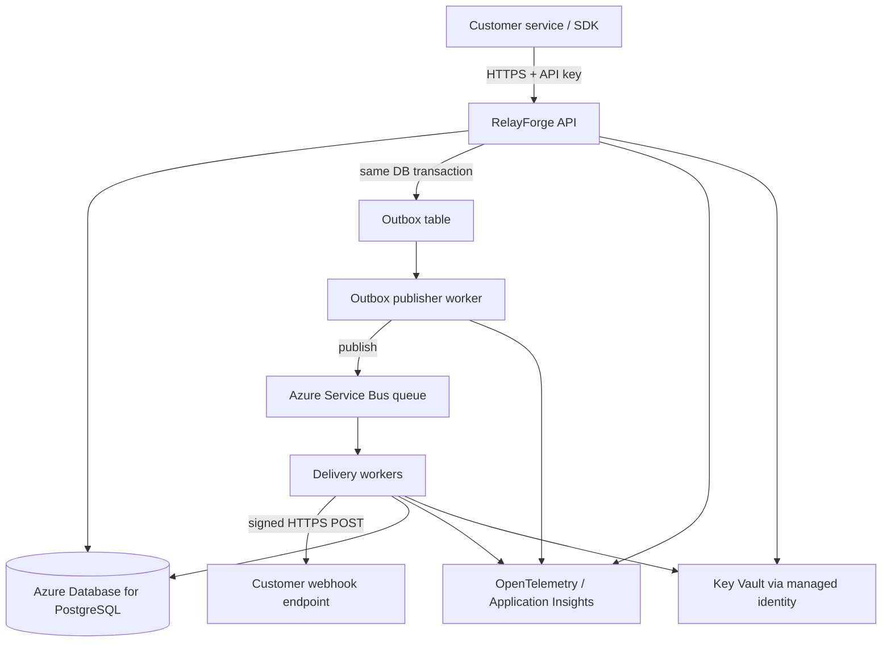
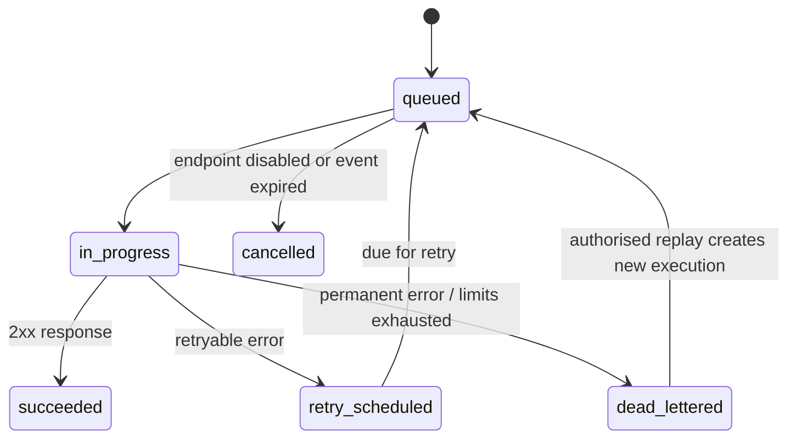

# RelayForge
## Architecture & Implementation Design Document

**Document version:** 1.0  
**Status:** Proposed baseline for implementation  
**Product type:** Multi-tenant webhook delivery platform  
**Primary implementation:** TypeScript / Node.js on Microsoft Azure  
**Audience:** Software engineers, technical interviewers, reviewers  
**Purpose:** Define a credible, secure, observable and testable product that can be implemented incrementally and demonstrated in a senior backend engineering interview.

---

## 1. Executive summary

RelayForge is a developer platform that accepts events from customer applications and delivers them to customer-owned HTTPS webhook endpoints with durable queuing, retries, signing, rate limiting, replay and delivery observability.

The product addresses a common integration problem: a sender should not have to implement and operate durable delivery, retry policy, delivery history and failure recovery independently for every integration.

The first release is intentionally narrow. It provides:
- Tenant and API-key authentication.
- Webhook endpoint registration.
- Event publishing with idempotency.
- Durable asynchronous delivery.
- HMAC-SHA256 request signatures.
- Delivery attempts, retry scheduling and dead-letter handling.
- Delivery search and controlled replay.
- Basic metrics, tracing, logs and a small dashboard or API-first demo.
- Local development with Docker Compose and a repeatable Azure deployment.

**Core engineering thesis:** accept an event durably, then deliver it asynchronously with at-least-once processing semantics and idempotent state transitions. Do not promise exactly-once delivery to arbitrary external HTTP endpoints.

### Product positioning

RelayForge is a portfolio-scale developer product, not a claim that the webhook infrastructure market is unserved. Commercial webhook platforms already exist. The portfolio value is in implementation quality, explicit trade-offs, measured performance, operational tooling and the ability to explain the design.

### Non-goals for v1

- General-purpose workflow automation.
- Arbitrary user code execution.
- Kafka cluster operations.
- Multi-region active-active writes.
- Exactly-once side effects at customer endpoints.
- Enterprise SSO, billing, complex plans or a full analytics warehouse.
- AI features that do not materially improve delivery reliability.
- Handling arbitrary binary payloads without size and content limits.

---

## 2. Goals, users and requirements

### 2.1 Primary users

1. **SaaS backend developer:** wants to publish events without owning retry infrastructure.
2. **Integration engineer:** needs delivery history, request signatures and replay.
3. **Platform engineer:** needs tenant isolation, rate limits, operational metrics and predictable failure behaviour.

### 2.2 Functional requirements

**FR-01 — Tenant authentication:** authenticate API calls using revocable API keys. Store only a cryptographic hash of each API key; reveal the secret once at creation.

**FR-02 — Endpoint management:** create, read, disable and rotate a webhook endpoint and its signing secret.

**FR-03 — Event acceptance:** validate event name and payload, enforce size limits and accept an idempotency key. Persist the event and an outbox record in one database transaction.

**FR-04 — Asynchronous delivery:** publish outbox records to Azure Service Bus. Workers retrieve messages and deliver signed HTTPS POST requests to enabled endpoints.

**FR-05 — Retry policy:** retry retryable failures with exponential backoff and jitter, bounded by maximum attempts and event age.

**FR-06 — Delivery history:** retain an attempt record with timestamps, response status, latency, a safe error summary and correlation IDs. Never store unrestricted secrets or full sensitive response bodies by default.

**FR-07 — Replay:** permit an authorised tenant user to replay a failed delivery. Replay creates a new delivery execution linked to the original event; it must not silently mutate historical attempt records.

**FR-08 — Idempotency:** duplicate publish requests with the same tenant and idempotency key return the original event result when the request fingerprint matches. Reuse with a different payload returns a conflict.

**FR-09 — Observability:** expose health checks, structured logs, distributed traces and operational metrics.

**FR-10 — Operator safety:** support a controlled dead-letter workflow, bounded replay and safe inspection without exposing signing secrets.

### 2.3 Non-functional requirements (initial targets)

These are design targets to test, not performance claims.

- **Correctness:** accepted events are durably recorded before returning success.
- **Delivery semantics:** at-least-once processing; duplicates are possible and documented.
- **Availability:** a queue or endpoint outage should not lose already accepted event records.
- **Latency:** API acceptance should not wait for the destination webhook response.
- **Isolation:** tenant-scoped data access must be enforced at the application/service layer and tested.
- **Security:** HTTPS-only destinations, SSRF protections, signed requests, least-privilege cloud identities and secret redaction.
- **Scale:** API and delivery workers can scale independently.
- **Cost:** support a low-cost local development mode and a small Azure demo environment.
- **Maintainability:** modular monolith boundaries first; split services only when independent deployment or scaling warrants it.

---

## 3. High-level architecture

### 3.1 Logical architecture



### 3.2 Runtime components

**API application**
- Fastify + TypeScript.
- Authentication, validation, tenant scoping, rate limits and public API.
- Writes event state and outbox row transactionally.
- Does not make webhook delivery calls inline.

**Outbox publisher**
- Polls PostgreSQL for unpublished outbox records using safe row claiming.
- Publishes to Service Bus using a stable message ID.
- Marks an outbox row as published only after broker acknowledgement.
- Retries transient errors with bounded delay; alert on growing outbox age.

**Delivery worker**
- Receives Service Bus messages in Peek-Lock mode.
- Claims/creates delivery state and sends a signed HTTPS request.
- Persists the attempt outcome before completing the queue message.
- If the worker crashes, the message may be redelivered; processing must be idempotent.
- Sends permanently failing messages to dead-letter handling after policy limits.

**PostgreSQL**
- System of record for tenants, API keys, endpoints, events, outbox records, deliveries and attempts.
- Uses transactions for consistency; indexes are designed around tenant-scoped queries and queue claiming.

**Azure Service Bus**
- Durable transport between the publisher and delivery workers.
- Standard or Premium tier should be selected based on required features, throughput and budget. Basic tier does not support duplicate detection; duplicate detection is an optimisation, not a replacement for application idempotency.
- Peek-Lock mode is used to avoid losing a message before processing is complete.

**Azure Container Apps**
- Hosts API, publisher and worker as separate apps or processes.
- API scales on HTTP load; workers scale using queue depth where supported and configured.
- Worker scale-to-zero behaviour and cold-start implications must be measured. For a demo, a minimum replica of one may simplify predictable processing at a cost.

**Azure Database for PostgreSQL Flexible Server**
- Managed relational store.
- Private networking is a production hardening option; use the least exposed configuration practical for the demo.

**Azure Key Vault + managed identity**
- Stores/controls secrets and keys. Use managed identity and RBAC instead of embedding Azure credentials in configuration.
- Per-endpoint signing secrets are encrypted at rest by the application/key-management approach and never returned by read APIs.

**Observability**
- OpenTelemetry SDK and instrumentation.
- Azure Monitor / Application Insights for traces, metrics and logs.
- Correlation identifiers flow from request to event, outbox, broker message, delivery and attempt.

### 3.3 Why a modular monolith first?

The API and domain logic should be organised as modules in one repository and can initially share a deployment unit where appropriate. The publisher and delivery worker are separate runtime processes because they have different scaling and failure characteristics. Avoid introducing a service for every domain entity. This reduces operational burden while preserving the most important independent scaling boundary: accepting requests versus executing deliveries.

---

## 4. Technology stack and rationale

| Concern | Choice | Reason | Trade-off / alternative |
|---|---|---|---|
| Language | TypeScript | Strong fit with existing Node.js experience; type safety across API and worker code | Keep strict compiler settings; types do not replace runtime validation |
| Runtime | Supported LTS Node.js | Mature async I/O ecosystem and Azure SDK support | Pin runtime and update on a planned cadence |
| HTTP framework | Fastify | Lightweight, schema-friendly and suitable for an API-first service | Express is familiar but less schema-centric by default |
| Validation | TypeBox or Zod (choose one) | Runtime validation and useful TypeScript types | Avoid maintaining duplicate validation rules |
| API contract | OpenAPI | Recruiter-friendly, testable API contract and interactive docs | Keep generated spec aligned with implementation |
| Database | PostgreSQL | Transactions, constraints, JSONB where useful, relational delivery history and strong indexing | Avoid storing unbounded event payloads indefinitely |
| Data access | `pg` with explicit SQL initially; optionally Kysely | Makes transactions, locking and query plans visible for a backend portfolio | ORM productivity may be preferable later; do not hide important concurrency logic |
| Messaging | Azure Service Bus | Managed durable queues, Peek-Lock, dead-lettering and Azure integration | Vendor-specific; add a transport adapter if portability becomes a real need |
| Local broker | Azure Service Bus emulator only if suitable, otherwise a local adapter/test double | Local work should not require cloud access for every test | Emulator feature parity may differ; run integration tests against Azure too |
| API and workers hosting | Azure Container Apps | Container-based deployment and event-driven scaling without managing Kubernetes | Scale behaviour and cold starts must be measured |
| Database hosting | Azure Database for PostgreSQL Flexible Server | Managed backups, maintenance and familiar SQL operations | Cost can dominate a small demo; use local PostgreSQL for most development |
| Secrets | Azure Key Vault | Centralised secrets and key lifecycle controls | Avoid a network call for every request; use secure caching and rotation design |
| Cloud auth | Microsoft Entra managed identity | Avoid long-lived cloud credentials in app settings | Local development uses developer credentials, not production secrets |
| Observability | OpenTelemetry + Application Insights / Azure Monitor | Standard instrumentation and useful Azure integration | Keep telemetry low-cardinality and redact payloads |
| Tests | Vitest, Fastify inject, Testcontainers where useful | Fast feedback, HTTP tests and realistic integration coverage | Keep a smaller fast unit-test suite |
| API integration tests | `undici` / Fastify inject | Test request/response contracts without starting a public server | Keep true network tests for a smaller suite |
| Load testing | k6 | Scriptable load tests and measurable latency/throughput | Report environment and test profile with every result |
| Containers | Docker + Compose | Repeatable local dependencies and onboarding | Containers do not substitute for cloud deployment validation |
| Infrastructure as code | Bicep | Azure-native, reviewable resource definitions | Terraform is reasonable if multi-cloud portability is a goal |
| CI/CD | GitHub Actions + Azure OIDC federation | Automated tests and deployment without a long-lived Azure client secret | Requires careful federated credential and environment setup |
| UI | Minimal React/Next.js dashboard, later | Helpful demo of the product; not needed to prove backend fundamentals | API-first implementation comes first |

### Key stack decisions

**Service Bus rather than Kafka for v1:** the product needs durable work distribution, retries and dead-letter handling, not a self-managed streaming platform. Service Bus reduces operations and is easy to explain in an Azure-focused architecture. Kafka remains a useful later adapter or comparison exercise if replayable event streams or broader fan-out become product requirements.

**PostgreSQL rather than Cosmos DB:** core data is relational and transaction-sensitive. Tenant, endpoint, event, outbox and delivery relationships benefit from SQL constraints and transactions. JSONB can store flexible event payloads without making the whole model schemaless.

**Container Apps rather than AKS:** the initial product does not justify Kubernetes operations. Container Apps provides containers, ingress and scaling with less infrastructure management.

**No Redis initially:** PostgreSQL can support API key lookup, idempotency, rate-limit counters and queue claiming at portfolio scale. Add Redis only after profiling demonstrates a need or a specific latency/rate-limit design requires it.

**No AI in the critical path:** AI does not solve webhook delivery reliability. Avoid adding an LLM merely for novelty. A later natural-language incident summary feature could be added only after the core product is correct and secure.

---

## 5. Domain model and persistence

All primary entities use UUIDs. Store timestamps in UTC. Every tenant-owned record includes `tenant_id`, and all tenant-scoped queries include that predicate. Use foreign keys and constraints to enforce relationships where possible.

### 5.1 Tables

**tenants**
- `id UUID PRIMARY KEY`
- `name TEXT NOT NULL`
- `status TEXT NOT NULL` (`active`, `suspended`)
- `created_at TIMESTAMPTZ NOT NULL`

**api_keys**
- `id UUID PRIMARY KEY`
- `tenant_id UUID NOT NULL REFERENCES tenants(id)`
- `key_prefix TEXT NOT NULL` — safe identifier for support/debugging
- `key_hash TEXT NOT NULL UNIQUE` — hash of secret using a suitable keyed or password-hashing strategy; never store raw API key
- `scopes TEXT[] NOT NULL`
- `last_used_at TIMESTAMPTZ`
- `expires_at TIMESTAMPTZ`
- `revoked_at TIMESTAMPTZ`
- `created_at TIMESTAMPTZ NOT NULL`

**webhook_endpoints**
- `id UUID PRIMARY KEY`
- `tenant_id UUID NOT NULL REFERENCES tenants(id)`
- `url TEXT NOT NULL`
- `description TEXT`
- `signing_secret_ciphertext BYTEA NOT NULL` — encrypted secret or reference to managed secret material
- `status TEXT NOT NULL` (`active`, `disabled`)
- `created_at TIMESTAMPTZ NOT NULL`
- `updated_at TIMESTAMPTZ NOT NULL`

**events**
- `id UUID PRIMARY KEY`
- `tenant_id UUID NOT NULL REFERENCES tenants(id)`
- `event_type TEXT NOT NULL`
- `payload JSONB NOT NULL`
- `payload_hash TEXT NOT NULL`
- `idempotency_key TEXT`
- `status TEXT NOT NULL` (`accepted`, `processing`, `completed`, `failed`, `partially_delivered`)
- `created_at TIMESTAMPTZ NOT NULL`
- `expires_at TIMESTAMPTZ`
- Unique constraint on `(tenant_id, idempotency_key)` where key is not null.

**outbox_events**
- `id UUID PRIMARY KEY`
- `tenant_id UUID NOT NULL`
- `event_id UUID NOT NULL REFERENCES events(id)`
- `message_type TEXT NOT NULL`
- `payload JSONB NOT NULL`
- `created_at TIMESTAMPTZ NOT NULL`
- `published_at TIMESTAMPTZ`
- `attempt_count INT NOT NULL DEFAULT 0`
- `next_attempt_at TIMESTAMPTZ NOT NULL DEFAULT now()`
- `last_error_code TEXT`
- `locked_by TEXT`
- `locked_until TIMESTAMPTZ`

**deliveries**
- `id UUID PRIMARY KEY`
- `tenant_id UUID NOT NULL`
- `event_id UUID NOT NULL REFERENCES events(id)`
- `endpoint_id UUID NOT NULL REFERENCES webhook_endpoints(id)`
- `status TEXT NOT NULL` (`queued`, `in_progress`, `succeeded`, `retry_scheduled`, `dead_lettered`, `cancelled`)
- `attempt_count INT NOT NULL DEFAULT 0`
- `next_attempt_at TIMESTAMPTZ`
- `last_attempt_at TIMESTAMPTZ`
- `succeeded_at TIMESTAMPTZ`
- `created_at TIMESTAMPTZ NOT NULL`
- `replay_of_delivery_id UUID NULL REFERENCES deliveries(id)`

**delivery_attempts**
- `id UUID PRIMARY KEY`
- `tenant_id UUID NOT NULL`
- `delivery_id UUID NOT NULL REFERENCES deliveries(id)`
- `attempt_number INT NOT NULL`
- `started_at TIMESTAMPTZ NOT NULL`
- `finished_at TIMESTAMPTZ`
- `http_status INT`
- `duration_ms INT`
- `outcome TEXT NOT NULL`
- `error_code TEXT`
- `response_excerpt TEXT` — optional, size-limited and redacted
- `trace_id TEXT`
- Unique constraint on `(delivery_id, attempt_number)`.

**idempotency_records** (optional separate table if event uniqueness cannot capture all semantics)
- `tenant_id UUID NOT NULL`
- `idempotency_key TEXT NOT NULL`
- `request_fingerprint TEXT NOT NULL`
- `resource_id UUID NOT NULL`
- `created_at TIMESTAMPTZ NOT NULL`
- `expires_at TIMESTAMPTZ`
- Primary key `(tenant_id, idempotency_key)`.

### 5.2 Important indexes

- `events (tenant_id, created_at DESC)`
- `deliveries (tenant_id, created_at DESC)`
- `deliveries (status, next_attempt_at)` for due work and operations
- `delivery_attempts (delivery_id, attempt_number DESC)`
- `outbox_events (next_attempt_at, created_at) WHERE published_at IS NULL`
- `webhook_endpoints (tenant_id, status)`
- Unique tenant/idempotency index.

Validate index choices with `EXPLAIN (ANALYZE, BUFFERS)` against representative data. Do not add indexes blindly: indexes improve reads but increase write cost and storage.

### 5.3 Payload retention

- Enforce a configurable maximum event payload size (initial default: 256 KiB; tune based on measured need).
- Define a retention policy for event payloads and attempt metadata.
- Avoid storing destination response bodies by default.
- If payloads must be stored in blob storage in the future, store a protected object reference and retention metadata.
- Never log full payloads by default.

---

## 6. Public API contract

Use `/v1` versioning. All responses return JSON. Errors use a consistent structure such as `{ "error": { "code": "VALIDATION_ERROR", "message": "...", "requestId": "..." } }`. Do not return stack traces or internal exception details.

### 6.1 Authentication

- `Authorization: Bearer rf_live_<secret>` for production-style keys; use a distinct prefix for test keys.
- Hash keys at creation and compare safely.
- Rate-limit by tenant and endpoint.
- Support revocation and expiry.
- Require TLS for all public API calls.

### 6.2 `POST /v1/endpoints`

Request:
```json
{
  "url": "https://customer.example.com/hooks/orders",
  "description": "Order event receiver"
}
```

Response `201 Created`:
```json
{
  "id": "uuid",
  "url": "https://customer.example.com/hooks/orders",
  "status": "active",
  "signingSecret": "shown-once",
  "createdAt": "2026-10-21T00:00:00Z"
}
```

The signing secret is shown only once. A subsequent GET must never return it.

### 6.3 `POST /v1/events`

Headers:
```http
Authorization: Bearer rf_live_<secret>
Idempotency-Key: client-generated-unique-value
Content-Type: application/json
```

Request:
```json
{
  "type": "order.created",
  "data": {
    "orderId": "ord_demo_123",
    "amount": 4999,
    "currency": "EUR"
  },
  "endpointIds": ["uuid"]
}
```

Response `202 Accepted`:
```json
{
  "eventId": "uuid",
  "status": "accepted",
  "acceptedAt": "2026-10-21T00:00:00Z",
  "statusUrl": "/v1/events/uuid"
}
```

The API validates the payload and endpoint ownership, starts a database transaction, inserts the event, inserts an outbox record and creates delivery records as required, then commits. It returns success only after commit. If the same idempotency key is used with the same fingerprint, return the original result. If the fingerprint differs, return `409 IDEMPOTENCY_KEY_REUSED`.

### 6.4 Other endpoints

- `GET /v1/events/{eventId}` — tenant-scoped event and aggregate status.
- `GET /v1/deliveries?status=failed&cursor=...&limit=50` — cursor-based pagination.
- `GET /v1/deliveries/{deliveryId}` — delivery details and safe attempt history.
- `POST /v1/deliveries/{deliveryId}/replay` — create a new replay delivery, subject to permissions and limits.
- `POST /v1/endpoints/{endpointId}/rotate-secret` — rotate secret; allow a short overlap only if the protocol and product explicitly support it.
- `PATCH /v1/endpoints/{endpointId}` — update description/status; URL changes may require endpoint verification.
- `GET /health/live` — process liveness.
- `GET /health/ready` — readiness based on critical dependencies, with bounded timeouts.
- `GET /metrics` — internal or protected metrics endpoint; do not expose tenant-sensitive metrics publicly.

### 6.5 Pagination and filtering

Use cursor-based pagination for high-volume history. A cursor should encode a stable ordering key such as `(created_at, id)`. Enforce maximum page size and allowed filters. Avoid unbounded list responses.

---

## 7. Webhook delivery protocol

### 7.1 Request headers

Each delivery sends:
- `Content-Type: application/json`
- `RelayForge-Event-Id: <event-id>`
- `RelayForge-Delivery-Id: <delivery-id>`
- `RelayForge-Timestamp: <unix-seconds>`
- `RelayForge-Signature: v1=<hex-hmac>`
- Optional `RelayForge-Attempt: <attempt-number>`

The signature is computed over a documented canonical string, for example:
`timestamp + "." + raw_request_body`

Use HMAC-SHA256 with the endpoint signing secret. Verify with a constant-time comparison. Document the exact bytes signed and provide a sample verifier in the repository. The receiver should reject timestamps outside a defined tolerance to reduce replay risk, while understanding that delivery retries may need a new timestamp and signature for each attempt.

### 7.2 Success and retry classification

- Treat configured 2xx responses as successful.
- Treat network errors and timeouts as retryable.
- Treat 408, 425, 429 and most 5xx responses as retryable; respect a bounded `Retry-After` value for 429/503.
- Treat most other 4xx responses as permanent failures by default, with an operator-configurable policy where justified.
- Never retry forever. Apply a maximum attempt count and maximum event age.
- Apply exponential backoff with full jitter, for example `delay = random(0, min(cap, base * 2^attempt))`. Exact values should be configurable and tested.
- Add a tenant-level and endpoint-level concurrency limit to avoid overwhelming customer systems.

### 7.3 Delivery state machine



Historical attempts are immutable records. A replay should create a new delivery linked to the original delivery or event, preserving auditability.

### 7.4 Exactly-once caveat

The platform cannot guarantee exactly-once external side effects. For example, a customer endpoint may process a request but the response can be lost before RelayForge records success. RelayForge may retry and the endpoint may receive the same event again. Use a stable event ID and document that receivers should deduplicate by event ID.

---

## 8. Reliability patterns

### 8.1 Transactional outbox

The API cannot atomically commit a PostgreSQL transaction and publish to Service Bus with one ordinary local transaction. Therefore:

1. Begin a PostgreSQL transaction.
2. Insert the event and required delivery rows.
3. Insert an outbox record in the same transaction.
4. Commit.
5. The publisher claims unpublished rows with a lease or `FOR UPDATE SKIP LOCKED`.
6. Publish using a stable message ID.
7. Mark the row published only after broker acknowledgement.
8. If the publisher crashes after publish but before marking the row, it may publish again; the consumer must be idempotent.

Keep database claiming short. Do not hold a database transaction open during a network call to Service Bus.

### 8.2 Queue consumer processing

Use Peek-Lock. The worker:
1. Receives the message.
2. Validates schema and identifiers.
3. Performs idempotent state transition / claims work.
4. Creates an attempt record.
5. Calls the destination with a strict timeout.
6. Persists the result and next action.
7. Completes the queue message only after the outcome is durably recorded.

If persistence fails, do not complete the message. A duplicate may be delivered; deduplicate with database constraints and state checks. If a poison message cannot be parsed, dead-letter it with a safe reason code and correlation ID.

### 8.3 Retry scheduling

Avoid sleeping inside a worker for long backoff intervals. Persist `next_attempt_at` and schedule the retry via an appropriate delayed-message mechanism or a due-work scheduler. Decide and document one strategy:
- **Initial implementation:** a retry scheduler queries due deliveries and enqueues them, using row locks/leases.
- **Alternative:** Service Bus scheduled messages if supported by the chosen tier and operational semantics.

Use a unique retry generation or attempt identifier so stale scheduled messages cannot execute an outdated retry.

### 8.4 Outbox leasing and concurrent publishers

Claim rows with a lease:
- select a bounded batch of unpublished, due rows whose lease is absent/expired;
- lock rows using `FOR UPDATE SKIP LOCKED`;
- set `locked_by` and `locked_until`;
- commit before publishing;
- clear/advance lease after publish result.

A crashed publisher's lease expires and another publisher can retry. Add jitter to avoid synchronized retries.

### 8.5 Dead-letter and replay

Dead-letter reasons should be finite codes such as `MAX_ATTEMPTS`, `INVALID_MESSAGE`, `ENDPOINT_POLICY_BLOCKED` or `EVENT_EXPIRED`. Do not include secrets or payloads in reason text. Replay requires tenant ownership, permission checks, a replay rate limit and a new execution record. Replaying must not bypass SSRF validation or endpoint disabled status.

---

## 9. Security and abuse prevention

Webhook delivery is an SSRF-sensitive feature because the service makes outbound HTTP requests to customer-configured URLs. Treat URL validation as a critical control, not a cosmetic check.

### 9.1 SSRF controls

- Require HTTPS in production.
- Reject URL credentials, unsupported schemes and malformed hosts.
- Reject localhost, loopback, link-local, private, multicast and reserved IP ranges, including IPv4-mapped IPv6.
- Resolve DNS and validate every resolved address before connecting.
- Defend against DNS rebinding: the validated address must be the address actually connected to, or the HTTP client must be configured with a safe lookup/pinning approach.
- Revalidate redirects; simplest v1 policy is to disable redirects.
- Block cloud metadata IPs and internal Azure endpoints.
- Apply outbound network controls where practical.
- Limit response size, connection time, total time and redirect count.
- Re-check destination policy on every delivery, not only when endpoint is created.

Consult the OWASP SSRF Prevention Cheat Sheet and validate implementation details against the actual Node.js HTTP client behaviour.

### 9.2 Secrets and identity

- Use managed identity for Container Apps access to Azure resources where supported.
- Use Azure RBAC with least privilege.
- Keep local `.env` files out of Git; commit only `.env.example`.
- Never put credentials in logs, screenshots, README examples or test fixtures.
- Store API keys as hashes. Store endpoint signing secrets encrypted or in a controlled secret store; document the trade-off between per-endpoint secrets and Key Vault object proliferation.
- Implement secret rotation and revocation.
- Use separate identities for API, publisher and delivery worker if practical.

### 9.3 Tenant isolation

- Derive `tenant_id` from authenticated credentials, never from an untrusted request body.
- Include tenant predicates in all queries.
- Verify that referenced endpoint IDs belong to the authenticated tenant.
- Test cross-tenant read, update, replay and secret-rotation attempts.
- Consider PostgreSQL Row-Level Security as defence in depth, not as a substitute for correct service-layer access control.

### 9.4 Abuse controls

- Payload size limits and JSON depth/complexity limits.
- Per-tenant request and event quotas.
- Per-endpoint delivery concurrency limits.
- Request timeouts and bounded response-body reads.
- Audit events for key creation/revocation, endpoint changes and replay.
- Retention and deletion policy for customer payloads.
- No unbounded retries, logs, queues or history queries.

---

## 10. Observability and operations

### 10.1 Structured logging

Use JSON logs with fields such as:
- `timestamp`, `level`, `service`, `environment`
- `request_id`, `trace_id`
- `tenant_id` (internal identifier only)
- `event_id`, `delivery_id`, `attempt_id`
- `operation`, `outcome`, `duration_ms`
- `error_code`

Never log API keys, signing secrets, authorization headers or full event payloads.

### 10.2 Metrics

Initial metrics:
- `api_requests_total` by route/status class (bounded labels)
- `api_request_duration_ms` histogram
- `events_accepted_total`
- `outbox_pending_count`
- `outbox_oldest_age_seconds`
- `deliveries_total` by outcome
- `delivery_attempt_duration_ms`
- `delivery_queue_age_seconds`
- `delivery_retries_total`
- `dead_letter_count`
- `worker_active_count`
- `destination_timeout_total`

Avoid tenant ID, full URL or event ID as metric labels; they create high cardinality. Use traces/logs for per-event investigation.

### 10.3 Tracing

Trace a publish request through:
API -> PostgreSQL transaction -> outbox publisher -> Service Bus message -> worker -> destination HTTP request.

Propagate trace context through message properties where possible. Trace the outbound HTTP call but avoid recording sensitive body contents.

### 10.4 Initial alerts

- Oldest unpublished outbox record exceeds a threshold.
- Queue age or queue depth grows continuously.
- Delivery success rate falls below a baseline.
- Dead-letter count increases unexpectedly.
- Worker exception rate spikes.
- Database connection saturation or elevated query latency.
- Azure spending crosses a budget alert.

Thresholds must be calibrated after baseline load tests.

---

## 11. Scaling strategy

### Stage 1 — portfolio MVP
- One API replica, one publisher and one or two delivery workers.
- One PostgreSQL database.
- Service Bus queue.
- Bounded event size and short retention.
- Demonstrate correctness and failure handling.

### Stage 2 — horizontal scale
- Scale API replicas on HTTP load.
- Scale workers using queue depth/oldest-message age where supported.
- Increase worker concurrency with explicit per-tenant/per-endpoint caps.
- Tune PostgreSQL pool sizes across all replicas to avoid exhausting connections.
- Batch outbox claims and tune indexes from query plans.
- Separate hot operational tables from large historical data if measurements justify it.

### Stage 3 — larger workload
Only after load testing:
- Partition or archive high-volume delivery history.
- Move large payloads to object storage.
- Introduce a cache for proven hot reads or distributed rate limiting if required.
- Consider separate databases or queue partitions for tenant isolation.
- Consider regional architecture based on actual latency and recovery objectives.
- Evaluate Kafka if replayable event streams, high fan-out or consumer ecosystem needs justify its operational cost.

### Scaling principles

- Scale workers based on backlog, not only CPU.
- Keep destination calls bounded by timeout and concurrency.
- Apply backpressure when a tenant or endpoint is failing.
- Avoid retry storms with jitter and circuit-breaking / temporary endpoint suppression.
- Measure before increasing architecture complexity.

---

## 12. Deployment architecture on Azure

### 12.1 Environments

- **Local:** Docker Compose for PostgreSQL and application services; use a Service Bus emulator only if its supported feature set meets test needs, otherwise use a local queue adapter for unit tests and a real Azure namespace for integration tests.
- **Development cloud:** separate resource group, limited service tiers, synthetic data and budget alerts.
- **Production-like demo:** separate identities, Key Vault, managed database, TLS, logging, backups and a documented deployment workflow.

### 12.2 Azure resources

- Resource group: `rg-relayforge-dev`
- Azure Container Apps environment
- Container App: `relayforge-api`
- Container App: `relayforge-outbox-publisher`
- Container App: `relayforge-delivery-worker`
- Azure Service Bus namespace and queue
- Azure Database for PostgreSQL Flexible Server
- Azure Key Vault
- Azure Container Registry
- Log Analytics / Application Insights
- Azure Monitor budget alerts
- Optional storage account for future large payloads

Use naming that can be parameterised by environment. Do not hardcode region, SKU or secret values in source code.

### 12.3 Infrastructure as code

Use Bicep with parameters for environment, location, SKU and naming. Review the generated changes before deployment. Use GitHub Actions OpenID Connect federation to Azure rather than storing a long-lived client secret in GitHub. Use managed identity from apps to Azure services where supported.

### 12.4 Deployment pipeline

1. Pull request: format/lint, typecheck, unit tests, dependency and secret scanning.
2. Build: build Docker image and tag with commit SHA.
3. Integration stage: run database and broker integration tests.
4. Publish image to Azure Container Registry.
5. Deploy to development environment.
6. Run smoke tests and readiness checks.
7. Promote only after checks pass; retain a rollback path to the previous image/revision.

---

## 13. Repository structure

```text
relayforge/
├── apps/
│   ├── api/
│   │   └── src/
│   ├── outbox-publisher/
│   │   └── src/
│   └── delivery-worker/
│       └── src/
├── packages/
│   ├── config/
│   ├── contracts/
│   ├── database/
│   ├── observability/
│   ├── security/
│   └── test-utils/
├── db/
│   ├── migrations/
│   └── seeds/
├── infra/
│   └── bicep/
├── tests/
│   ├── integration/
│   ├── contract/
│   └── load/
├── docs/
│   ├── architecture/
│   ├── decisions/
│   ├── runbooks/
│   └── diagrams/
├── scripts/
├── docker-compose.yml
├── .env.example
├── package.json
├── README.md
└── SECURITY.md
```

Use a workspace tool such as pnpm workspaces. Keep contracts and shared types small. Do not create a giant `common` package that becomes a dumping ground.

### Module boundaries

- `identity`: API key verification and tenant context.
- `endpoints`: endpoint lifecycle and URL safety.
- `events`: validation, idempotency and event acceptance.
- `outbox`: transactional publishing.
- `deliveries`: delivery state machine and retry policy.
- `messaging`: Service Bus adapter and message contracts.
- `observability`: logs, metrics and traces.
- `admin`: controlled operational functions.

Business logic should not depend directly on Azure SDK classes. Use a small adapter interface for the queue transport and test it with a fake implementation.

---

## 14. Testing strategy

### Unit tests
- Retry delay calculation and jitter bounds.
- HMAC signature generation and verification.
- URL validation and IP range checks.
- Idempotency fingerprint comparison.
- Delivery state transitions.
- Retry classification by status/exception.
- Tenant permission policy.

### API integration tests
- Valid event returns 202 only after database commit.
- Same idempotency key and same body returns the original event.
- Same key with different body returns 409.
- Cross-tenant event or endpoint access is denied.
- Invalid endpoint URL is rejected.
- Disabled endpoint cannot be delivered to.
- Payload and page-size limits are enforced.

### Messaging integration tests
- Outbox publisher retries after a broker outage.
- Duplicate broker message does not create duplicate logical delivery.
- Worker crash before settlement results in safe redelivery.
- Permanent message errors enter dead-letter handling.
- Database failure prevents queue completion.
- Stale retry messages cannot override a newer delivery state.

### Security tests
- SSRF attempts to loopback, private IPs, metadata endpoints, IPv6 and DNS-rebinding scenarios are blocked.
- Redirects to private destinations are blocked.
- Secrets are absent from logs and API responses.
- Tenant boundaries are tested for every resource type.
- Rate limits and body size limits are enforced.

### Load and chaos tests
- Publish sustained and burst traffic at a documented rate.
- Simulate destination 500s, timeouts and slow responses.
- Kill workers during delivery.
- Stop the publisher temporarily.
- Restart the database in a controlled non-production environment.
- Observe queue age, outbox age, recovery time and duplicate handling.

Every performance result must record test duration, event payload size, target endpoint behaviour, Azure region/SKU, replica counts and commit SHA. Do not publish a throughput number without its test conditions.

---

## 15. Implementation plan and definition of done

### Milestone 0 — project skeleton
- Workspace, linting, strict TypeScript, environment config.
- Docker Compose PostgreSQL.
- CI runs formatting, typecheck and unit tests.
- README explains local setup.

**Done when:** a new developer can clone the repository and run the checks using documented commands.

### Milestone 1 — API and data model
- Migrations, tenant and API-key model.
- Endpoint CRUD with secret redaction.
- Event acceptance and idempotency.
- OpenAPI documentation.

**Done when:** integration tests prove tenant isolation, transaction rollback and idempotency behaviour.

### Milestone 2 — outbox and messaging
- Transactional outbox.
- Publisher leases and retry.
- Service Bus adapter.
- Message contract versioning.

**Done when:** a broker outage does not lose accepted events, and a duplicate publish is handled safely.

### Milestone 3 — delivery worker
- HTTPS delivery, signature generation, timeouts.
- Attempt persistence and retry scheduling.
- Dead-letter handling and replay.

**Done when:** a controlled test endpoint can simulate 2xx, 4xx, 429, 500 and timeout responses with expected state transitions.

### Milestone 4 — security and operations
- SSRF protections, rate limits, secret management.
- Structured logs, tracing, metrics and health endpoints.
- Retention policy and operator runbook.

**Done when:** security tests pass and an operator can diagnose a failed delivery using event/delivery IDs without reading secrets.

### Milestone 5 — Azure deployment
- Bicep infrastructure.
- Managed identity and GitHub Actions OIDC.
- Container Apps and cloud integrations.
- Budget alert and cleanup instructions.

**Done when:** a documented pipeline deploys the application and a smoke test successfully delivers a signed webhook to a controlled HTTPS endpoint.

### Milestone 6 — portfolio polish
- Architecture diagram and ADRs.
- Load-test report.
- Demo video.
- README screenshots and sample API calls.
- Known limitations and next steps.

**Done when:** a reviewer can understand the product in five minutes and run the core path in fifteen minutes, assuming prerequisites are installed.

---

## 16. Architecture decision records (ADRs)

### ADR-001: Azure Service Bus for v1
**Decision:** Use Azure Service Bus as the managed work queue.  
**Reason:** Durable asynchronous processing, Peek-Lock semantics and dead-letter support with low operational overhead.  
**Consequences:** Azure-specific integration; use an adapter boundary and test the actual selected tier. Kafka is a future alternative if product requirements justify it.

### ADR-002: PostgreSQL as source of truth
**Decision:** Store business state, outbox and delivery history in PostgreSQL.  
**Reason:** Transactions, constraints and relational queries fit the consistency needs.  
**Consequences:** Must manage connection pools, indexes, retention and database growth.

### ADR-003: Transactional outbox
**Decision:** Write event and outbox row in one transaction; publish asynchronously.  
**Reason:** Avoid the database-commit/message-publish dual-write gap.  
**Consequences:** Publisher leases, duplicate publication and idempotent consumers are required.

### ADR-004: At-least-once delivery
**Decision:** Document at-least-once processing and require receiver-side deduplication for side effects.  
**Reason:** An external endpoint can process a request while its response is lost; the sender cannot know with certainty whether the side effect occurred.  
**Consequences:** Duplicate requests are possible; stable event IDs and signatures are provided.

### ADR-005: Container Apps rather than AKS
**Decision:** Use Azure Container Apps for API and worker containers.  
**Reason:** Lower operations burden for a small, independently scalable application.  
**Consequences:** Validate scaling, networking and cold-start behaviour; migrate only if requirements demand Kubernetes-specific control.

### ADR-006: API-first; dashboard later
**Decision:** Complete API, reliability and operational basics before a polished UI.  
**Reason:** Backend quality is the project's primary portfolio goal.  
**Consequences:** The first demo can use Swagger and a CLI/script; add a small dashboard once the system is reliable.

---

## 17. Risks and mitigations

| Risk | Mitigation |
|---|---|
| SSRF lets users reach internal services | Strict URL/IP/DNS validation, redirects disabled, connection pinning and outbound network controls |
| Duplicate external effects | Stable event IDs, documented at-least-once semantics and receiver-side idempotency |
| Outbox table grows without bound | Retention, batch processing, alerting and archival |
| Retry storm during customer outage | Exponential backoff, full jitter, concurrency limits and temporary endpoint suppression |
| Tenant data leakage | Tenant-scoped queries, authorization tests and optional row-level security |
| Azure demo costs become high | Local development, small SKUs, budget alerts, resource cleanup and short load tests |
| Overengineering delays portfolio | Milestone gates; no Redis/Kafka/Kubernetes/AI until justified |
| Secret leakage | Key hashing, Key Vault, managed identity, log redaction and secret scanning |
| Worker starvation by slow endpoints | Per-endpoint timeouts, bounded concurrency and queue-age monitoring |
| Replay causes unintended duplicate processing | Explicit replay permissions, audit trail, rate limits and new delivery execution IDs |

---

## 18. Demo and interview narrative

A strong demo should tell one end-to-end story:

1. Create a tenant API key and register a controlled HTTPS webhook endpoint.
2. Publish an `order.created` event with an idempotency key.
3. Show the API returns quickly with `202 Accepted`.
4. Make the receiver return HTTP 500; show a failed attempt and scheduled retry.
5. Restore the receiver; show eventual successful delivery.
6. Publish the same request with the same idempotency key and show no duplicate logical event.
7. Simulate a worker restart and explain why redelivery is safe.
8. Show the trace from API request through queue to outbound HTTP request.
9. Run a small load test and discuss measured bottlenecks.
10. Explain the trade-offs: at-least-once semantics, transactional outbox, tenant isolation, cost and why Service Bus was chosen over Kafka for v1.

### Interview questions to prepare

- Why not deliver the webhook synchronously from the API?
- What if PostgreSQL commits but Service Bus is unavailable?
- What if Service Bus accepts a message but the publisher crashes before marking the outbox row?
- What if the destination processes the event but the response is lost?
- How do you prevent a malicious tenant from targeting Azure metadata endpoints?
- How do you enforce fair usage across tenants?
- How would you scale from 100 events/sec to 10,000 events/sec?
- Which database indexes would you add, and how would you validate them?
- How do you avoid exhausting PostgreSQL connections as worker replicas scale?
- What is the difference between broker duplicate detection and application idempotency?
- When would you introduce Kafka, Redis, partitioning or separate databases?
- How would you reduce cost while retaining useful observability?

---

## 19. External technical references

Use these as the primary implementation references; check the selected SDK version and current service-tier constraints during implementation.

1. **Azure Container Apps overview** — deployment, jobs and scaling: https://learn.microsoft.com/en-us/azure/container-apps/overview
2. **Container Apps scaling** — HTTP and event-driven scaling rules: https://learn.microsoft.com/en-us/azure/container-apps/scale-app
3. **Service Bus message loss and duplicates** — Peek-Lock, settlement and idempotent consumers: https://learn.microsoft.com/en-us/azure/service-bus-messaging/service-bus-message-loss-and-duplicates
4. **Service Bus duplicate detection** — scope and configuration: https://learn.microsoft.com/en-us/azure/service-bus-messaging/enable-duplicate-detection
5. **Azure transactional outbox pattern** — consistency across database and messaging: https://learn.microsoft.com/en-us/azure/architecture/databases/guide/transactional-out-box-cosmos
6. **Container Apps managed identity** — service authentication without embedded credentials: https://learn.microsoft.com/en-us/azure/container-apps/managed-identity
7. **Azure Key Vault overview** — secret and key management: https://learn.microsoft.com/en-us/azure/key-vault/general/overview
8. **Azure Well-Architected Framework** — reliability, security, cost and operations: https://learn.microsoft.com/en-us/azure/well-architected/what-is-well-architected-framework
9. **OWASP SSRF Prevention Cheat Sheet** — outbound URL validation and SSRF defence: https://cheatsheetseries.owasp.org/cheatsheets/Server_Side_Request_Forgery_Prevention_Cheat_Sheet.html
10. **OpenTelemetry documentation** — instrumentation and context propagation: https://opentelemetry.io/docs/

---

## 20. Final implementation guidance

Build the smallest vertical slice first:

1. `POST /v1/events` writes event + outbox in one PostgreSQL transaction.
2. Publisher moves the outbox event into Service Bus.
3. Worker sends a signed request to a controlled test endpoint.
4. Worker persists the attempt and completes the queue message.
5. Automated tests prove duplicate and failure behaviour.

Then add retries, replay, SSRF controls, metrics, Azure deployment and load testing.

Do not start with the dashboard, multi-region deployment, AI, Kafka and a complex microservice topology. The core product is a reliable event-to-webhook delivery pipeline. Make that correct, explainable and measurable first.
